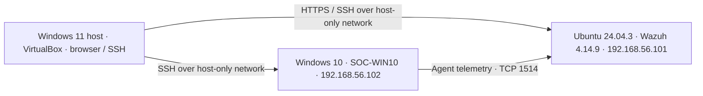

# SOC Home Lab — Windows Authentication Monitoring with Wazuh

A hands-on SOC L1 portfolio project: collect Windows security events, investigate a failed logon, and validate Wazuh's built-in correlation for repeated logon failures.

**Author:** Faris Alhussain  
**Lab validation date:** 31 October 2026  
**Status:** Initial detection scenario validated; further scenarios are planned.

## What was demonstrated

- Connected a Windows 10 endpoint to a Wazuh 4.14.9 server.
- Verified Windows Logon auditing was configured for Success and Failure.
- Generated a controlled local authentication failure for the nonexistent account `soc-test-user`.
- Verified Windows Security Event ID `4625` and Wazuh rule `60122` (level 5).
- Generated repeated local failures and observed rule `60204`, “Multiple Windows Logon Failures” (level 10).
- Investigated a time-filter issue by tracing alerts from the manager to the indexer and comparing system clocks.

This project validates **existing Wazuh rules**. It does not claim to implement a custom detection or simulate a remote brute-force attack.

## Lab architecture



Both VMs also have a NAT adapter for installation and updates. The displayed addresses are private lab addresses. See [lab setup](docs/lab-setup.md) for resources, access paths, and limitations.

## Investigation

Read the [case report](reports/001-repeated-local-logon-failures.md) for the evidence, detection logic, analyst disposition, and limitations.

| Evidence | Screenshot |
|---|---|
| Endpoint registered and active | [Agent status](screenshots/01-agent-active.png) |
| Original Windows 4625 event | [Windows event](screenshots/02-windows-4625.png) |
| Single-failure detection | [Rule 60122](screenshots/03-single-failure.png) |
| Repeated-failure detection | [Rule 60204](screenshots/04-repeated-failures.png) |
| Correlated account | [Target user](screenshots/05-target-user.png) |
| Correlated source | [Loopback source](screenshots/06-source-address.png) |
| Configured correlation frequency | [Frequency](screenshots/07-frequency.png) |

## Reusable searches

In Wazuh Threat Hunting → Events (DQL):

```text
agent.id:"001" AND data.win.system.eventID:"4625"
```

```text
agent.id:"001" AND rule.id:"60204"
```

Use a time range covering the experiment. Synchronize the host and guest clocks before testing.

## Skills practiced

Windows event analysis · SIEM alert triage · correlation validation · evidence handling · basic Linux administration · VirtualBox networking · troubleshooting telemetry delivery.

## Next steps

- Validate a successful-logon scenario with a dedicated local test account.
- Compare benign repeated failures with a separate, authorized remote test.
- Document false-positive considerations and an escalation playbook.
- Export selected sanitized event JSON as additional evidence.

These steps are planned, not completed.

## References

- [Wazuh quickstart](https://documentation.wazuh.com/current/quickstart.html)
- [Wazuh Windows agent deployment](https://documentation.wazuh.com/current/installation-guide/wazuh-agent/wazuh-agent-package-windows.html)
- [Microsoft Event 4625](https://learn.microsoft.com/en-us/windows/security/threat-protection/auditing/event-4625)

## Publication scope

Only selected lab screenshots and documentation are included. Credentials, keys, installer credential archives, VM disks, and full personal logs are excluded. Screenshots retain synthetic lab identifiers for traceability.
