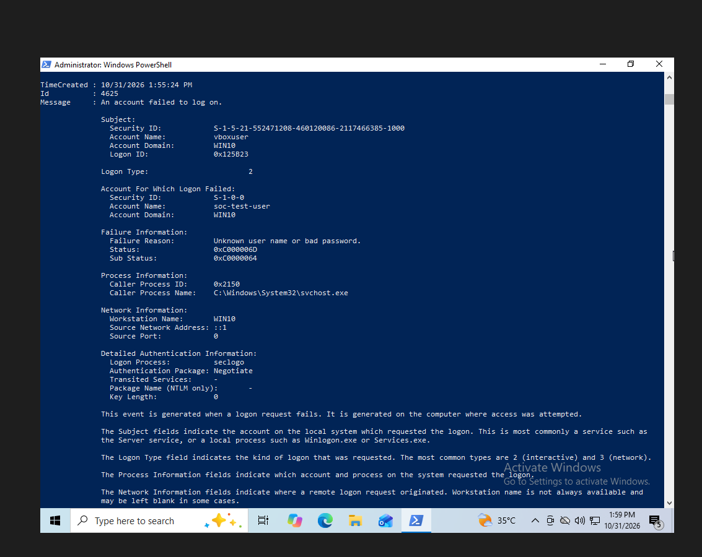
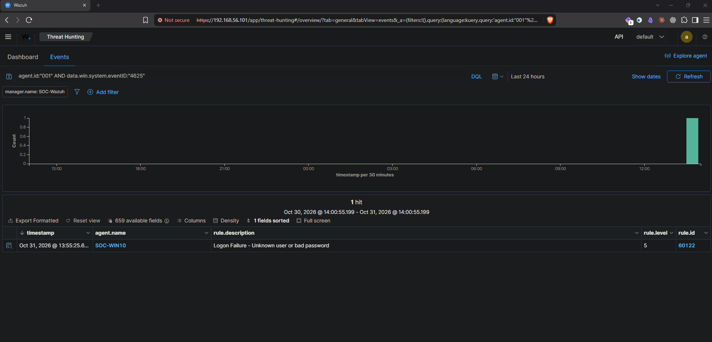
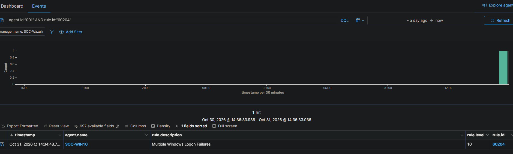

# Case 001 — Repeated local Windows logon failures

## Summary

On 31 October 2026, controlled authentication attempts using the nonexistent local account `soc-test-user` generated Windows Event ID 4625 on the lab endpoint. Wazuh produced individual failure alerts under rule 60122 and, after a repeated-attempt test, a “Multiple Windows Logon Failures” alert under rule 60204.

**Disposition:** Authorized lab activity; detection validated. No incident escalation is required for this known test. This result is not evidence of an external compromise.

## Scope

- Endpoint: SOC-WIN10 / Windows computer name WIN10.
- Agent ID: 001.
- Host-only IP: 192.168.56.102.
- Manager: SOC-Wazuh, 192.168.56.101.
- Target account: soc-test-user (not created).
- Simulation: local process launch with invalid credentials, including execution through an SSH session.
- No password guessing against a real user's account and no successful test-account logon were demonstrated.

## Evidence timeline

Times below are displayed local times in the captured interfaces; UTC offsets were not independently exported with every screenshot. They should not be presented as a forensic UTC timeline.

| Displayed time, 31 October 2026 | Observation |
|---|---|
| 13:55:24, Windows event | Event 4625: account failed to log on, target soc-test-user |
| Approximately 13:55:25, Wazuh | Rule 60122, level 5, on SOC-WIN10 |
| Approximately 14:04:26–14:04:35, Wazuh | Additional individual failures appeared |
| Approximately 14:34:48, Wazuh | Rule 60204, level 10, “Multiple Windows Logon Failures” |

The repeated-attempt procedure requested 12 attempts with a two-second delay. The screenshot proves the correlated alert occurred; the complete per-attempt transcript was not included, so exact attempt-to-alert counting was not independently reconciled.

## Original Windows event



Observed fields:

| Field | Value |
|---|---|
| Event ID | 4625 |
| Target account | soc-test-user |
| Target domain | WIN10 |
| Logon Type | 2 |
| Status | 0xC000006D |
| Substatus | 0xC0000064 |
| Source Network Address | ::1 |
| Caller Process Name | C:\Windows\System32\svchost.exe |

The unknown account is consistent with the selected nonexistent test identity. The loopback source identifies a local authentication request; it is not a remote attacker address. The earlier SSH connection to Windows does not make this specific authentication event a remote-network logon.

## Detection validation



Rule 60122 matched the individual authentication failure at level 5.

The installed rule file showed rule 60204 with:

```xml
<rule id="60204" level="10" frequency="$MS_FREQ" timeframe="240">
  <if_matched_group>authentication_failed</if_matched_group>
  <same_field>win.eventdata.ipAddress</same_field>
```

The installed variable definition was:

```xml
<var name="MS_FREQ">8</var>
```

This configuration correlates failures in the authentication_failed group using the same source-address field within 240 seconds. The frequency value is a rule setting, not the total number of attempts executed. No custom rules or changes to the default ruleset were made.



The correlated alert's captured details matched:

- Target account: soc-test-user.
- Source address: ::1.
- Rule frequency: 8.
- Rule ID: 60204.
- Rule level: 10.

## Analyst assessment

**Detection outcome:** The SIEM identified individual failures and a repeated-failure pattern during the controlled test.

**Context:** The operator intentionally used invalid credentials for a nonexistent account. The source was local, and the activity was expected.

**Disposition:** Close as authorized test activity. This is expected detection behavior, rather than proof that the rule produced an erroneous match.

**Limits:** A rule label associated with repeated failures does not establish malicious intent, remote brute force, password compromise, or successful access. Those conclusions would require additional evidence.

For an unexplained production alert, investigate the target account, source, logon type, failure codes, frequency, and nearby successful logons; check with the account owner and follow the organization's escalation process.

## Reproduction

Only run inside an authorized lab. In Windows PowerShell on the test endpoint:

```powershell
$pass = Read-Host "Enter a test password" -AsSecureString
$cred = [pscredential]::new("$env:COMPUTERNAME\soc-test-user", $pass)
Start-Process cmd.exe -Credential $cred
```

The invalid-credentials error is expected. Confirm the underlying event before relying on the process error alone:

```powershell
Get-WinEvent -FilterHashtable @{LogName='Security'; Id=4625} -MaxEvents 1 |
    Format-List TimeCreated,Id,Message
```

For the bounded repeated-failure test, reuse the same test credentials:

```powershell
1..12 | ForEach-Object {
    try {
        Start-Process cmd.exe -Credential $cred -ErrorAction Stop
    } catch {
        Write-Host "Attempt $_ failed: $($_.Exception.Message)"
    }
    Start-Sleep -Seconds 2
}
```

Review Wazuh Events using:

```text
agent.id:"001" AND rule.id:"60204"
```

An error from Start-Process alone is insufficient evidence of a 4625 event or a correlation match. Verify the Windows event, Wazuh alert, and relevant fields as done in this case.
